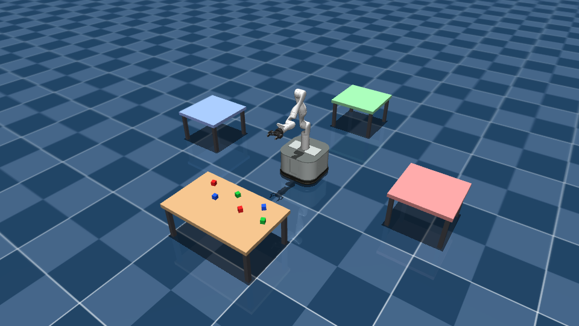

# Сортировка кубиков мобильным манипулятором

Мобильный робот с рукой и камерой на запястье находит цветные кубики на столе и развозит их
по столам их цвета. Целевое железо: KUKA youBot с камерой Intel RealSense D435 под ROS 2 Jazzy.
Пока робота нет, всё отлаживается в симуляторе MuJoCo на готовой модели похожей конструкции
(Stanford TidyBot), так, чтобы при переходе на железо логика не менялась.



## Что реализовано

- **Сцена в MuJoCo:** четыре стола, шесть кубиков трёх цветов, всенаправленная база с семизвенной рукой.
- **Зрение:** по цветному кадру и глубине находит кубики, их цвет, положение и поворот.
- **Модель камеры RealSense D435:** шум и пропуски глубины, рабочая дальность, угол обзора.
- **Движения:** подъезд к столу, наведение руки, захват и постановка кубика, проверка, взят ли он.
- **Полный цикл сортировки:** осмотр стола, память о кубиках, захват в два взгляда (издалека и вблизи),
  реакция на сбои, повторный осмотр.
- **Оболочка ROS 2:** те же зрение и логика работают как узлы ROS 2 в контейнере Docker,
  а симулятор подключается к ним через топики, как настоящий робот.

В симуляции робот развозит все шесть кубиков за 232 с модельного времени (около 9 с без окна).
Устройство кода и причины решений описаны в [docs/ARCHITECTURE.md](docs/ARCHITECTURE.md).

## Запуск

Нужен Linux с OpenGL (подойдёт встроенная графика) и Python 3.10+.

```bash
python3 -m venv .venv
source .venv/bin/activate
pip install -e ".[dev]"
```

Примеры идут от простого к сложному:

| Команда                                | Что делает                                             |
| -------------------------------------- | ------------------------------------------------------ |
| `python examples/01_view.py`           | сцена в интерактивном окне MuJoCo                      |
| `python examples/02_inspect.py`        | из чего состоит модель: сочленения, приводы, камеры    |
| `python examples/03_teleop.py`         | управление базой и захватом с клавиатуры               |
| `python examples/04_pick_and_place.py` | один кубик, положение берётся из симулятора            |
| `python examples/05_cameras.py`        | кадры и карты глубины с камер в `out/`                 |
| `python examples/06_detect_cubes.py`   | зрение на одном кадре и его ошибка относительно истины |
| `python examples/07_pick_by_vision.py` | один кубик, положение только от камеры                 |
| `python examples/08_sort_all.py`       | полный цикл сортировки                                 |

Примеры 4, 7 и 8 принимают ключ `--headless` (без окна). В окне примеров 3, 7 и 8 в углу показан
вид с камеры на запястье: цвет и глубина.

Тесты (около минуты):

```bash
pytest
```

### Через ROS 2

ROS 2 ставить не нужно: он работает в контейнере. Нужен Docker.

```bash
docker/run.sh
```

Первый запуск собирает образ (несколько минут, около 2.6 ГБ). Затем стартуют мост с симулятором,
узел зрения и узел сортировки; в конце результат сверяется с симулятором. Другие варианты:

| Команда | Что делает |
|---|---|
| `docker/run.sh ros2 launch sortbot_ros sorting.launch.py speed:=2.0` | симуляция вдвое быстрее часов |
| `docker exec -it sortbot /entrypoint.sh bash` | второй терминал в работающем контейнере |
| `docker/run.sh python3 -m pytest -p no:cacheprovider tests ros/sortbot_ros/test` | все тесты в контейнере |

## Ограничения

- **Проверено только в симуляции.** На настоящем роботе и настоящей камере код не запускался.
- **Модель робота не youBot.** У TidyBot семь сочленений и захват 85 мм, у youBot пять и ход пальцев
  около 20 мм. Параметры движений (`MotionConfig`) подобраны под TidyBot.
- **Положение базы и столов известно заранее:** база из симулятора, столы из сцены или параметров.
  Лидара и локализации нет.
- **Нет объезда препятствий и проверки столкновений руки:** база едет по прямой.
- **Зрение:** пороги цвета подобраны под освещение симулятора; два кубика одного цвета вплотную
  и частично закрытые кубики не находятся.
- **Модель камеры приблизительная:** нет бликов, смаза и ошибок совмещения цвета с глубиной.
- **ROS 2:** рука управляется потоком целевых углов, а не действием `FollowJointTrajectory`;
  окна с трёхмерной сценой в контейнере нет.

Дальше по плану: модель youBot, лидар и локализация, перенос на робота.

## Лицензии

Модель робота в `models/stanford_tidybot/` взята из
[MuJoCo Menagerie](https://github.com/google-deepmind/mujoco_menagerie) (коммит `370c439`)
без изменений. Её лицензии: [models/stanford_tidybot/LICENSE](models/stanford_tidybot/LICENSE).
